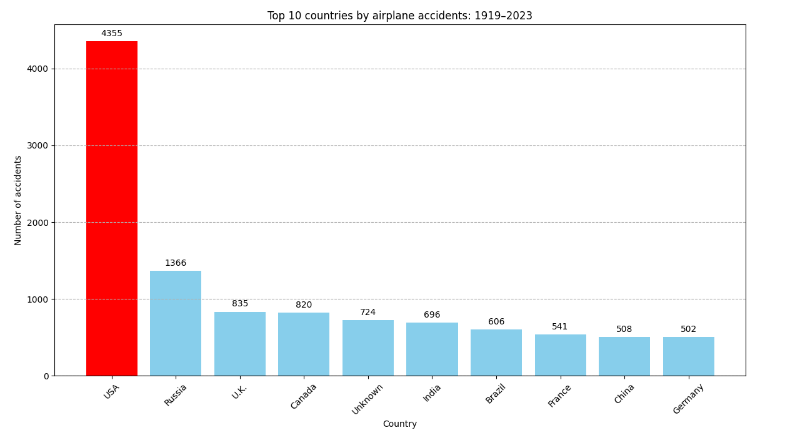
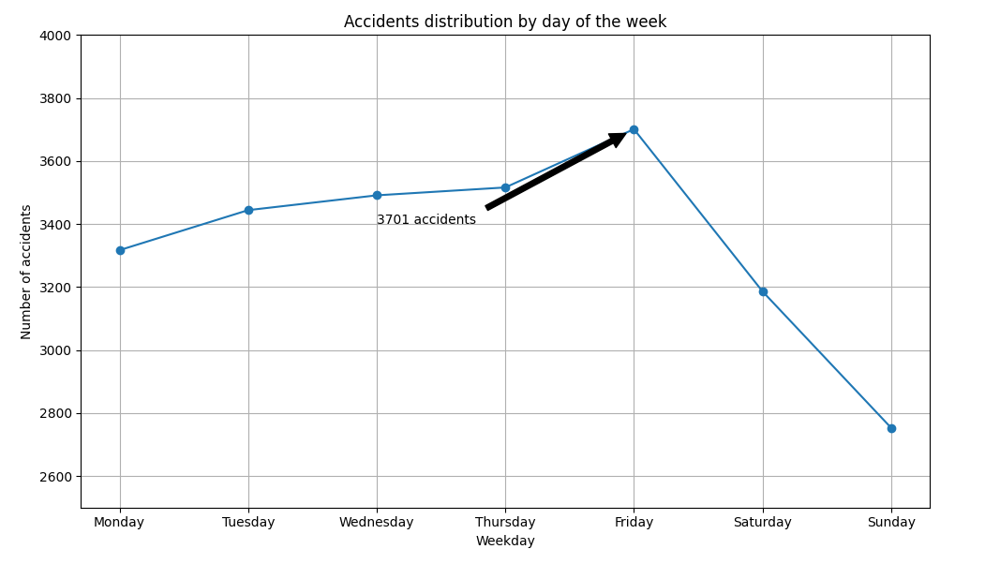
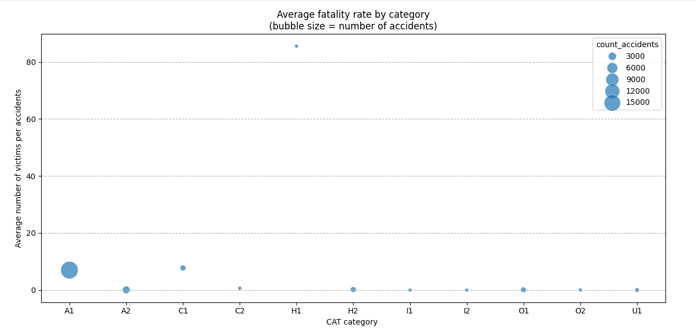
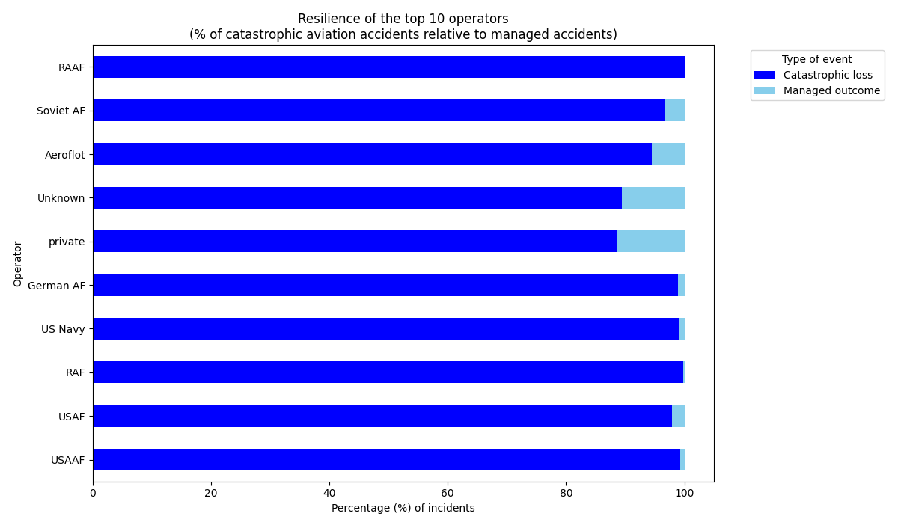
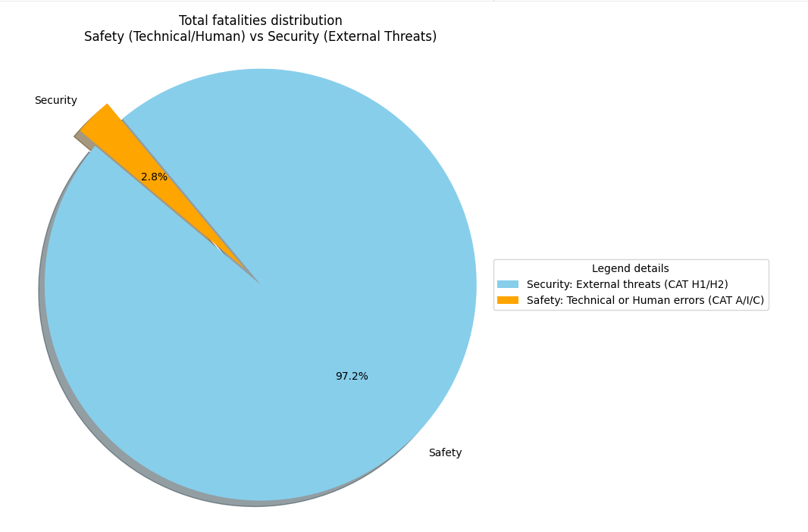
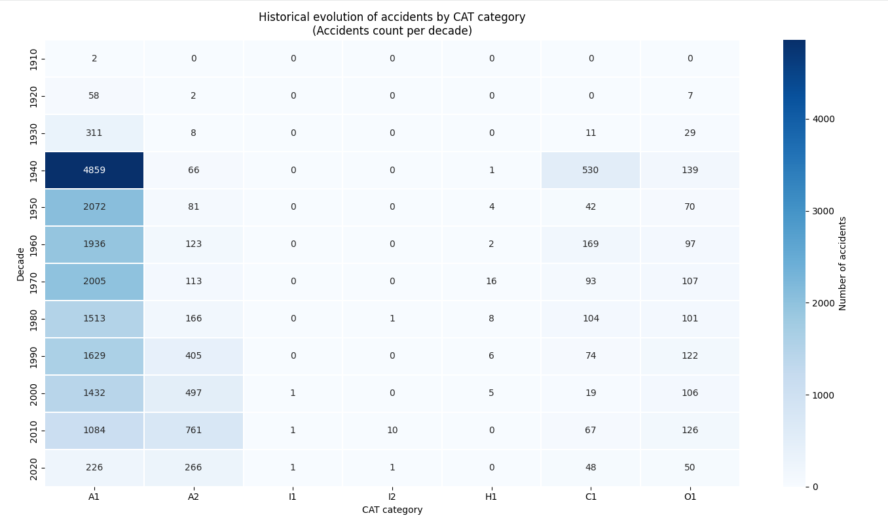
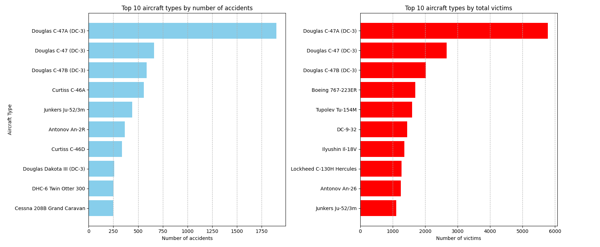
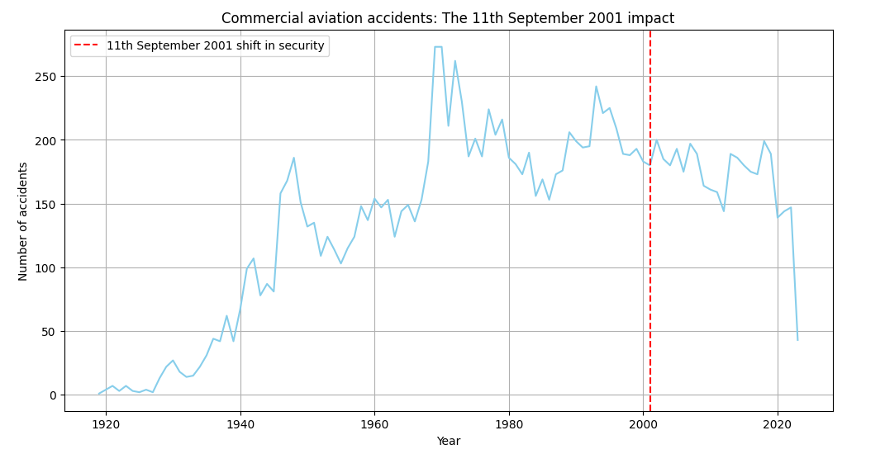
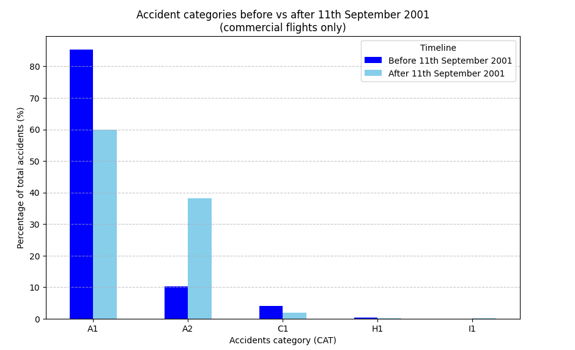
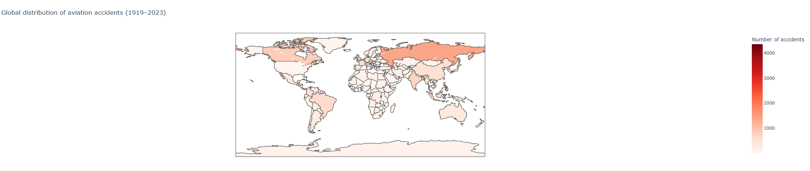

# ✈️ Analysis of Air Disasters from 1919 to 2023
## 📌 Project Overview
This project focuses on analyzing aviation accidents recorded worldwide between 1919 and 2023, with the aim of identifying historical trends, geographical patterns, and factors associated with aviation incidents.

The project is based on a scenario in which the newly established International Alliance for Safe Skies (IASS) commissions a comprehensive analysis of historical aviation accident data to gain insights into aviation safety and support future safety improvement initiatives.

The analysis uses a dataset containing nearly 24,000 aviation accident records, covering more than a century of aviation history.

Through Python, data cleaning, Exploratory Data Analysis (EDA), statistical aggregation, and data visualization techniques, the project investigates accident frequency, geographical distribution, aircraft types, operators, fatalities, and the evolution of aviation accidents over time.

Particular attention is given to the historical impact of September 11, 2001, by comparing commercial aviation accident patterns before and after this event.

The project also includes an interactive geographical visualization illustrating the global distribution of aviation accidents.

## 🗂️ Dataset
**Dataset:** aviation-accidents.csv

The dataset contains approximately 24,000 records of aviation accidents occurring between 1919 and 2023.

**Data Format:** CSV file.

**Main Features:**

- **Date:** Date of the aviation accident.
- **Type:** Aircraft type or model.
- **Registration:** Aircraft registration code.
- **Operator:** Airline or organization operating the aircraft.
- **Fatalities:** Number of fatalities associated with the accident.
- **Location:** Geographic location where the accident occurred.
- **Country:** Country where the accident occurred.
- **CAT:** Accident category according to the Aviation Safety Network (ASN).
  
The dataset also includes a year field used for historical and temporal analysis.

## 🎯 Project Objectives
The main objectives of the project were:

- Explore and analyze aviation accident records covering the period 1919–2023.
- Identify the countries with the highest number of aviation accidents.
- Investigate whether accidents occur more frequently on specific days of the week.
- Analyze historical accident trends across different decades.
- Compare aircraft types according to accident frequency and total fatalities.
- Examine accident outcomes among the most frequently involved operators.
- Investigate the distribution of fatalities between Safety and Security-related incidents.
- Explore the relationship between accident categories and average fatalities.
- Analyze changes in commercial aviation accident patterns before and after September 11, 2001.
- Create a geographical visualization representing the worldwide distribution of aviation accidents.
  
## 🛠️ Tools & Techniques
- Python
- Google Colab
- Pandas
- NumPy
- Matplotlib
- Seaborn
- Plotly Express
- Data Cleaning and Preprocessing
- Exploratory Data Analysis (EDA)
- Missing Values Handling
- Data Type Conversion
- String Standardization
- Date and Time Analysis
- Data Aggregation and Grouping
- Statistical Analysis
- Cross-tabulation and Pivot Tables
- Categorical Data Analysis
- Historical Trend Analysis
- Data Visualization
- Interactive Choropleth Maps

## 📂 Project Structure
The project was developed using Python and organized into the following main analytical stages:

- Dataset Import and Initial Exploration
- Data Cleaning and Preprocessing
- Geographical Analysis
- Temporal Analysis
- Aircraft and Operator Analysis
- Safety and Security Analysis
- Historical Accident Trends
- September 11, 2001 Impact Analysis
- Geographical Data Visualization
- Project Workflow

**1. Data Import and Initial Exploration**

The aviation accidents dataset was imported directly from the provided CSV source using Pandas.

An initial exploration was performed to understand the dataset structure, identify the available variables, and examine data types and missing values.

Key activities:

- Importing the CSV dataset.
- Creating a copy of the original DataFrame.
- Analysis of dataset dimensions and column information.
- Examining data types and missing values.
- Identification of inconsistencies that require data cleansing.
  
**2. Data Cleaning and Preprocessing**

Several data cleaning operations were performed to improve data consistency and prepare the dataset for analysis.

Key preprocessing activities:

- Converting the *date* column into datetime format.
- Converting the *year* column into numeric format.
- Removing records with missing or invalid date and year information.
- Converting the year field into integer format.
- Replacing missing registration values with "-".
- Replacing missing operator, location, and country values with "Unknown".
- Standardizing missing country descriptions.
- Removing leading and trailing whitespace from textual columns.
- Cleaning the *fatalities* column by converting numerical strings into integers.
- Handling records containing multiple fatality values separated by a plus sign, summing the individual values.
  
After data cleaning, the dataset was reduced from **23,966 to 23,408 records**, resulting in a cleaned dataset ready for analysis.

**3. Geographical Analysis – Accidents by Country**

The first analytical stage investigates the geographical distribution of aviation accidents.

The analysis identifies the ten countries with the highest number of recorded accidents.

Key activities:

- Grouping accident records by country.
- Counting the number of accidents per country.
- Ranking countries according to accident frequency.
- Identifying the countries with the highest accident counts.

A bar chart was created using Matplotlib to compare the top ten countries, highlighting the country with the highest number of recorded accidents.

**4. Temporal Analysis – Accidents by Day of the Week** 

This analysis investigates whether aviation accidents are distributed evenly across the days of the week.

The weekday was extracted from the accident date using Pandas datetime functionality.

Key activities:

- Extracting weekday names from accident dates.
- Counting accidents for each day of the week.
- Ordering weekdays chronologically, from Monday to Sunday.
- Comparing accident frequencies across the seven days.

A line chart was created to visualize the distribution.

**Key Finding:**

Friday recorded the highest number of accidents, with 3,701 recorded incidents.

**5. Accident Categories and Fatality Analysis**

The Aviation Safety Network (ASN) category field was used to investigate accident severity and the distribution of different accident outcomes.

The original categories were grouped into wide analytical classifications:

- **Catastrophic Loss:** Categories A1 and C1, representing fatal or total-loss outcomes.
- **Managed Outcome:** Categories A2, I1, I2, and C2, representing incidents with managed outcomes.
- **Other:** Remaining categories, including H1, H2, O1, O2, U1, and U2.

Missing accident categories were assigned to U1 for the purposes of this analysis.

Average fatalities and accident frequency were calculated for each original ASN category.

A bubble chart was created using Seaborn to visualize:

- Average number of fatalities per accident.
- Accident category.
- Number of recorded accidents, represented by bubble size.

This visualization allows different accident categories to be compared according to both frequency and average fatality figures.

**6. Operator Analysis – Accident Outcomes**

This stage investigates the accident outcomes associated with the ten most frequently involved aircraft operators.

To focus on the selected accident outcome categories, records classified as "Other" were excluded.

Key activities:

- Identifying the ten operators with the highest accident frequency within the selected categories.
- Filtering the dataset to include only these operators.
- Creating a cross-tabulation between operators and accident outcome classifications.
- Calculating the percentage distribution of outcomes for each operator.
- Comparing catastrophic losses with managed outcomes.

A horizontal stacked bar chart was created to compare the percentage distribution of accident outcomes across the selected operators.

This analysis provides a comparative overview of accident outcomes, rather than an absolute ranking of operator safety, since the dataset does not include the total number of flights operated by each organization.

**7. Safety vs Security Analysis**

The accident categories were also used to distinguish between Safety-related and Security-related events.

For this analysis, incidents belonging to categories containing the letter H were classified as Security, while the remaining categories were classified as Safety.

The total number of fatalities was then calculated for each group.

A pie chart was created to visualize the proportion of fatalities associated with each classification.

The analysis provides an overview of the distribution of recorded deaths between events related to operational safety and external security threats, according to the classification adopted in the project.

**8. Historical Analysis – Evolution of Accidents by Decade**

This stage explores how aviation accident categories have evolved throughout the period covered by the dataset.

Accidents were grouped into decades using the year field.

Key activities:

- Creating a decade variable by grouping years into ten-year intervals.
- Grouping accident records by decade and ASN category.
- Counting the number of incidents for each category and decade.
- Selecting the main accident categories for comparison.
- Creating a decade-by-category pivot table.
- A heatmap was generated using Seaborn to visualize the historical evolution of aviation accident categories.

The color intensity represents the number of recorded accidents, making it easier to identify changes in accident frequency and category distribution over time.

**9. Aircraft Analysis – Accident Frequency and Fatalities**

This analysis investigates which aircraft types are most frequently involved in aviation accidents and which are associated with the highest total number of fatalities.

Records containing generic or unidentified aircraft descriptions, such as "Unknown" and "Private", were excluded from this specific analysis.

Two separate rankings were created:

- **Top 10 Aircraft Types by Accident Frequency:** Identifies the aircraft types with the highest number of recorded accidents.
- **Top 10 Aircraft Types by Total Fatalities:** Identifies the aircraft types associated with the highest cumulative number of fatalities.

Two horizontal bar charts were created side by side to facilitate comparison.

This analysis highlights the distinction between accident frequency and total fatalities, providing two different perspectives on historical aviation accident records.

**10. Historical Impact Analysis – September 11, 2001**

This stage investigates the evolution of commercial aviation accidents before and after September 11, 2001.

Military and private/non-commercial operators were excluded using keyword-based filtering of the operator field.

The date September 11, 2001, was selected as a historical reference point to divide the dataset into two periods:

- **Before September 11, 2001:** Accidents recorded before the reference date.
- **After September 11, 2001:** Accidents recorded on or after the reference date.

Key activities:

- Filtering out military and private/non-commercial operators.
- Grouping commercial aviation accidents by year.
- Visualizing annual accident frequency.
- Highlighting September 11, 2001, on the historical trend chart.
- Comparing the distribution of selected ASN accident categories between the two periods.
- Calculating category percentages within each period.

Two visualizations were created:

- A line chart showing the historical evolution of commercial aviation accidents.
- A grouped bar chart comparing the percentage distribution of selected accident categories before and after September 11, 2001.

This analysis provides a descriptive overview of changes in commercial aviation accident patterns across the two periods, without assuming a direct causal relationship with the historical event.

**11. Geographical Visualization – Global Accident Distribution**

As an additional visualization, an interactive world choropleth map was created using Plotly Express.

Before generating the map, records with missing or non-geographical country values were excluded, including:

- Unknown
- ?
- Atlantic Ocean
- Pacific Ocean
- Indian Ocean
- Arctic Ocean

Country names were standardized to improve geographical matching.

Key activities:

- Filtering records with valid country information.
- Standardizing country names.
- Counting accidents by country.
- Generating a world choropleth map using Plotly Express.
- Applying a red color scale to represent accident frequency.

The resulting interactive map highlights the geographical distribution of aviation accidents worldwide between 1919 and 2023.

Users can hover their cursor over individual countries to examine the number of incidents for each.

## 💡 Business and Social Value
The analysis of historical aviation accidents provides several potential benefits for aviation safety research and decision-making:

- **Aviation Safety Monitoring:** Identifies geographical and historical patterns in recorded aviation accidents.
- **Risk Awareness:** Highlights aircraft types and accident categories associated with high accident frequencies or fatalities.
- **Historical Benchmarking:** Provides insights into how aviation accident patterns have evolved over more than a century.
- **Operator Analysis:** Supports comparative analysis of accident outcomes among frequently involved operators.
- **Security Awareness:** Examines the distribution of fatalities associated with Safety and Security-related accident classifications.
- **Data-Driven Decision Making:** Provides historical evidence that can support further aviation safety investigations and policy discussions.
- **Geographical Insights:** Uses interactive mapping to make global accident distributions easier to understand and communicate.

The results must be interpreted within the context of the recorded incident data. A simple count of incidents does not measure actual flight risk, as exposure variables—such as the number of flights, flight hours, number of passengers, and aircraft movements—are not available in the dataset.

## 🎓 Conclusion
This project demonstrates how Python and data analytics techniques can be used to investigate more than a century of aviation accident records.

Through data cleaning, Exploratory Data Analysis, statistical aggregation, and data visualization, the project explores geographical distributions, temporal patterns, aircraft characteristics, operator outcomes, fatalities, and historical changes in aviation accidents.

Particular attention was given to the comparison of accident patterns before and after September 11, 2001, as well as the geographical representation of worldwide aviation accidents through an interactive choropleth map.

The analysis also highlights the importance of distinguishing between accident frequency, accident gravity, and fatalities when interpreting aviation safety data.

Overall, this project strengthened my practical skills in Python, Pandas, NumPy, Matplotlib, Seaborn, Plotly, data cleaning, exploratory data analysis, statistical analysis, and data visualization.

It also provided precious experience in transforming a large historical dataset into meaningful insights through structured analytical processes and visual storytelling.

## 📁 Repository Contents
- **[Analysis_of_Aviation_Disasters_from_1919_to_2023.ipynb](Analysis_of_Aviation_Disasters_from_1919_to_2023.ipynb):** Python notebook containing the complete data cleaning, preprocessing, exploratory analysis, statistical aggregations, visualizations, and geographical analysis.
- **[DATA](DATA):** Folder containing the dataset, if included in the repository.
- **[images](images):** Folder containing screenshots of the main analytical visualizations, if included in the repository.

## 📸 Project Preview
The following visualizations showcase the main analytical results:

## Top 10 Countries by Aviation Accidents: 
Geographical ranking of countries according to accident frequency.

## Accidents by Day of the Week: 
Distribution of accidents across weekdays.

## Average Fatalities by Accident Category: 
Bubble chart comparing accident categories, average fatalities, and event frequency.

## Operator Accident Outcomes: 
Comparison of catastrophic and managed outcomes among the top ten operators.

## Safety vs Security Fatalities: 
Distribution of fatalities between the two analytical classifications.

## Historical Evolution by Decade: 
Heatmap showing accident categories across different decades.

## Aircraft Types Analysis: 
Comparison of aircraft types by accident frequency and total fatalities.

## September 11, 2001 Impact Analysis: 
Historical accident trends and category distribution before and after the event.

## Global Accident Distribution: 
Interactive choropleth map representing aviation accident frequency by country.

## 📬 Contact
- **Silvia Venturini**
- [LinkedIn](https://www.linkedin.com/in/silvia-venturini92/)
- **Email:** silvia.venturini92@hotmail.com
